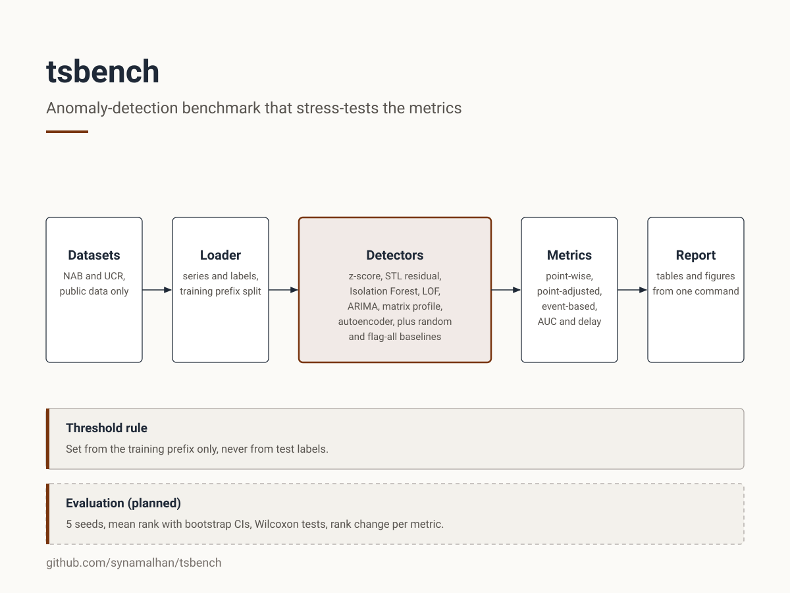

# tsbench

Anomaly-detection benchmark that stress-tests the metrics.

> **Status: in progress.** This repo currently holds the design only. Nothing is implemented yet, and no results are reported until they are measured.

tsbench runs a set of time-series anomaly detectors on public datasets and scores them with several metrics. The goal is to show how much the ranking of detectors depends on the metric, including point-adjusted scoring.

## Architecture

## Plan

- [ ] Loaders for NAB and UCR, with a training prefix split
- [ ] Detectors: z-score, STL residual, Isolation Forest, LOF, ARIMA, matrix profile, autoencoder
- [ ] Baselines: random and flag-all
- [ ] Threshold chosen from the training prefix only
- [ ] Metrics: point-wise, point-adjusted, event-based, AUC and detection delay
- [ ] One-command report with tables and figures
- [ ] Write-up

## Evaluation (planned)

5 seeds, mean rank with bootstrap confidence intervals, Wilcoxon tests, and rank change per metric.

## Planned stack

Python, NumPy, pandas, scikit-learn, statsmodels, stumpy, PyTorch.

## Notes

Datasets are not included. Check the NAB and UCR licenses and access terms before use.
